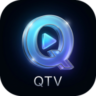
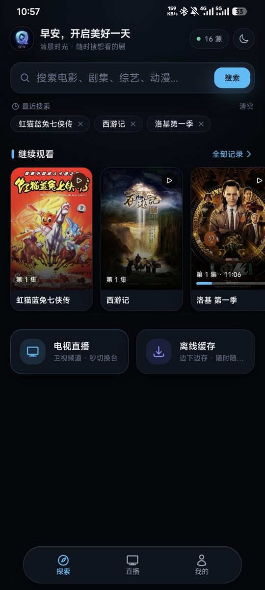
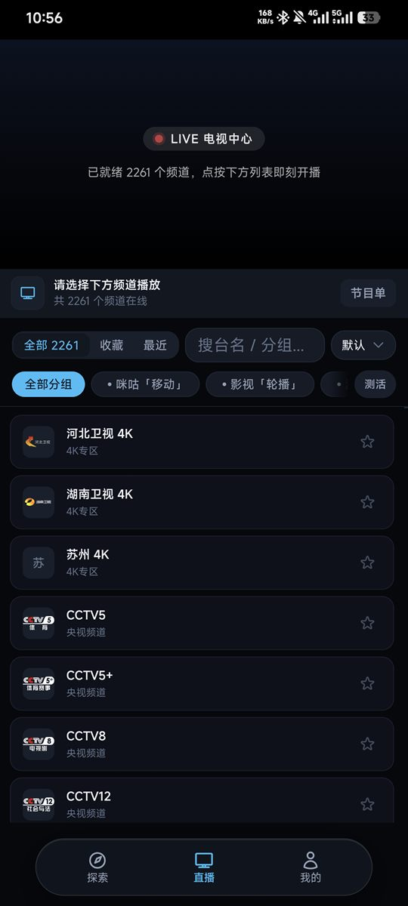
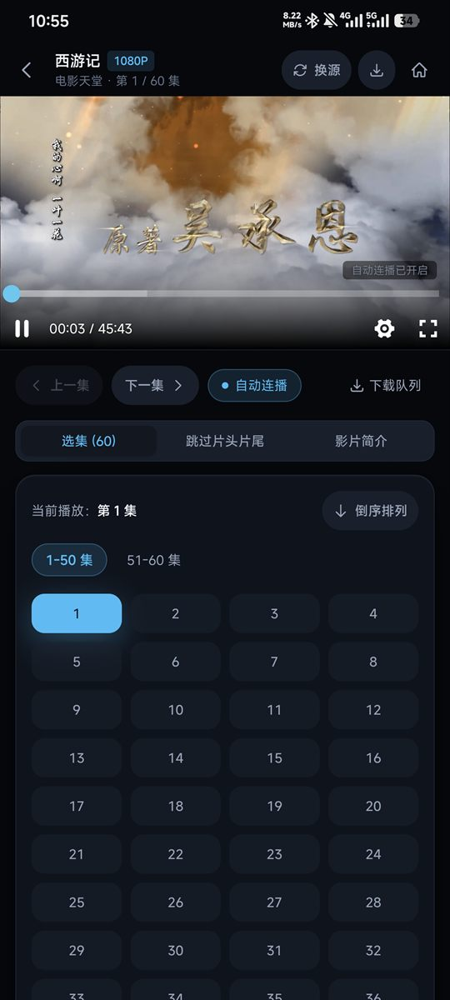
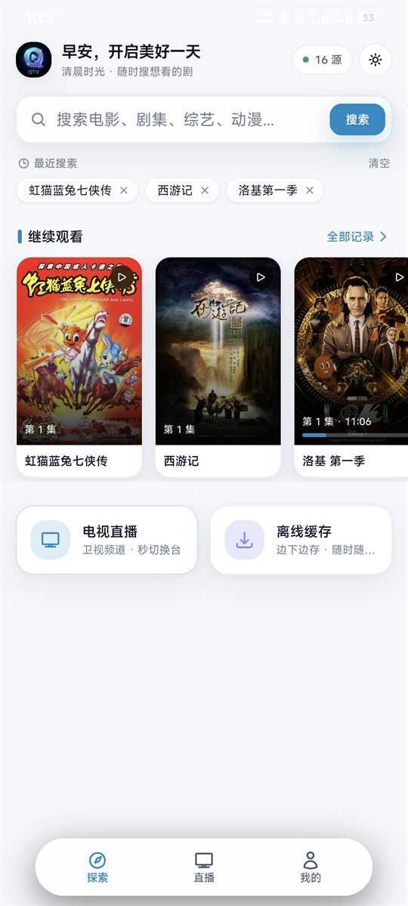
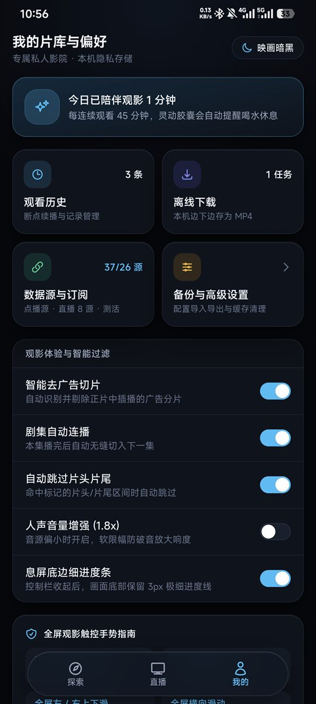
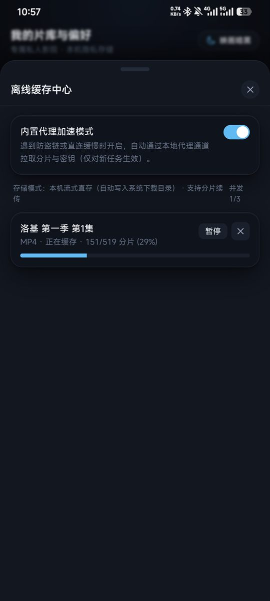

<div align="center">
  
  <h1>QTV</h1>
  <p>基于 WebView 与本地代理引擎的跨平台移动端影视点播与电视直播客户端，支持 Android 与 iOS。</p>
  <p>
    
    
    
    
  </p>
  <p>
    <a href="https://github.com/HapyRain/QTV/actions/workflows/build-mobile.yml"></a>
    <a href="https://github.com/HapyRain/QTV/releases"></a>
  </p>
</div>

## 简介

**QTV** 是一款脱离服务端独立运行的移动端视频聚合播放器，前端基于 [LibreTV](https://github.com/LibreSpark/LibreTV) 针对手机单手交互重制。

原版项目依赖 Node.js 服务端完成跨域请求与流媒体中转，QTV 将全部后端接口下沉至手机本地（Android 端基于 Kotlin + [OkHttp](https://square.github.io/okhttp/) 拦截，iOS 端基于 Swift + 本地 Loopback 服务），安装到手机即可直连公开采集接口与直播源，无需部署服务器或内网穿透。

> 🖥️ **桌面端（Windows / macOS / Linux）正在开发中，敬请期待。**

## 应用截图 / Screenshots

| 探索 · 深色 | 直播中心 | 点播工作台 |
| :---: | :---: | :---: |
|  |  |  |

| 探索 · 浅色 | 我的片库 | 离线缓存 |
| :---: | :---: | :---: |
|  |  |  |

## 功能特性

- **无服务端直连**：本地完成接口聚合、跨域代发、GBK/UTF-8 自动转码与重定向追踪，装机即用。
- **多源并发搜索**：支持导入自定义采集站、CMS 接口与 TVBox 订阅链接，并发检索结果并自动探测源站画质与测速延迟。
- **M3U8 切片去广告**：内置 HLS 清单解析器，基于 `EXT-X-DISCONTINUITY`、分片时长特征与路径规则自动过滤插播广告切片。
- **电视直播与节目单**：支持 M3U 直播源导入、频道分组切换、多线路无缝换源，以及 XMLTV（含 `.xml.gz`）EPG 电子节目单解析。
- **本地离线缓存**：支持将 HLS 视频流合并转封装并直接导出至系统相册/下载目录（Android `MediaStore` / iOS「文件」App）。
- **全屏手势与交互**：底部三栏导航（探索 / 直播 / 我的）、底部抽屉面板；进入全屏自动横屏，**全屏下**左半屏上下滑调亮度、右半屏上下滑调音量、横滑拖动进度、双击左右快退/快进 10 秒、长按 3 倍速，观影满 45 分钟弹出休息提醒。
- **数据备份与迁移**：支持将源列表、订阅地址、观看历史与播放器设置一键导出为 JSON 备份文件。

## 安装说明

前往仓库 [Releases](https://github.com/HapyRain/QTV/releases) 或 Actions 构建产物页面下载对应平台的安装包：

| 平台 | 系统要求 | 安装方式 |
| :--- | :--- | :--- |
| **Android** | Android 8.0 (API 26) 及以上 | 下载 `.apk` 安装包直接安装 |
| **iOS / iPadOS** | iOS 15.0 及以上 | 下载未签名 `.ipa`，通过 [TrollStore](https://github.com/opa334/TrollStore)、[AltStore](https://altstore.io/)、[SideStore](https://sidestore.io/) 或 [Sideloadly](https://sideloadly.io/) 自签安装 |
| **桌面端** | Windows / macOS / Linux | 开发中，敬请期待 |

### 首次配置数据源

应用本身不内置任何影视内容，首次打开后请按以下步骤添加数据源：

1. 进入底部 **「我的」** → 点 **「数据源与订阅」**，打开 **「片源与偏好设置」** 面板。
2. **聚合订阅**：在「片源管理 → 聚合订阅」里粘贴 QTV 源列表链接或 TVBox 接口 JSON 链接，点同步即可批量导入点播源与直播源。
3. **手动点播源**：在「片源管理 → 点播源」里单独添加 CMS 采集接口，并勾选启用（未勾选的源不参与搜索）。
4. **直播源**：在「片源管理 → 直播源」里添加 `.m3u` / `.m3u8` 地址及可选的 EPG 节目单链接；也可以从底部 **「直播」** 页的「管理直播源」入口直接进入。

## 从源码构建

### 环境要求

- **Web 前端**：[Node.js](https://nodejs.org/) 20+
- **Android 端**：JDK 17、Android SDK (API 36)
- **iOS 端**：macOS 14+、Xcode 15+

### 1. 构建前端静态资源

前端基于 [Next.js](https://nextjs.org/)、[ArtPlayer](https://artplayer.org/) 与 [hls.js](https://github.com/video-dev/hls.js) 构建。修改 `web/` 目录下的前端代码后，执行以下命令重新生成静态产物并同步至双端工程目录：

```bash
node scripts/build-web.mjs
```

该脚本会自动完成静态导出，并将产物同步至 `app/src/main/assets/www`（Android）与 `ios/QTV/Resources/www`（iOS）。仓库已包含最新预编译静态资源，若未改动前端代码可跳过此步。

### 2. 编译 Android 端

```bash
./gradlew :app:assembleDebug
```

编译完成后，APK 产物位于 `app/build/outputs/apk/debug/app-debug.apk`。

### 3. 编译 iOS 端

- **本地 Xcode 运行**：打开 `ios/QTV.xcodeproj`，在 `Signing & Capabilities` 中配置个人开发者账号（Personal Team）与唯一 Bundle ID，连接设备后按 `⌘R` 运行。
- **GitHub Actions 自动构建**：推送代码或手动触发 `.github/workflows/build-mobile.yml` 工作流，云端将自动打包生成 `QTV-Android-APK` 与免签名 `QTV-iOS-Unsigned.ipa`。

## 目录结构

```text
.
├── app/                        # Android 宿主工程 (Kotlin)
│   └── src/main/
│       ├── java/org/qtv/app/
│       │   ├── MainActivity.kt # WebView 宿主、横竖屏切换、文件导出桥接
│       │   ├── api/            # 本地 /api/* 路由拦截与实现
│       │   ├── core/network/   # OkHttp 客户端与字符集解码
│       │   ├── data/           # CMS 检索、TVBox 解析、M3U/EPG 解析、画质探测
│       │   └── player/hls/     # M3U8 广告分片过滤
│       └── assets/www/         # Android 预编译前端资源
├── ios/                        # iOS 宿主工程 (Swift 5.9)
│   ├── QTV.xcodeproj/          # Xcode 工程文件
│   └── QTV/
│       ├── App/                # WKWebView 宿主、系统音量/亮度调节、文件导出桥接
│       ├── Api/                # 本地 127.0.0.1:18688 服务与 /api/* 路由实现
│       ├── Core/               # URLSession 网络层与编码识别
│       ├── Data/               # CMS、TVBox、M3U/EPG、画质探测 Swift 实现
│       ├── Player/             # M3U8 广告过滤与相对路径重写
│       └── Resources/www/      # iOS 预编译前端资源
├── web/                        # 移动端前端源码 (Next.js + React + Tailwind CSS)
├── scripts/build-web.mjs       # 前端打包与双端静态资源同步脚本
└── .github/workflows/          # Android APK 与 iOS IPA 自动构建流水线
```

## 致谢与许可

- 前端基础架构衍生自开源项目 [LibreTV](https://github.com/LibreSpark/LibreTV)，遵循 [AGPL-3.0](https://www.gnu.org/licenses/agpl-3.0.html) 开源许可证发布。
- **免责声明**：QTV 仅提供本地播放器界面与公开网络接口检索工具，不存储、不制作、不分发任何音视频文件。所有数据均由用户自行配置的第三方源站提供，使用本项目产生的任何版权与合规风险由使用者自行承担。
