<div align="center">
  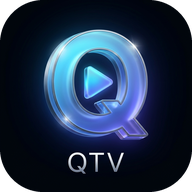
  <h1>QTV</h1>
  <p>基于 WebView 与本地代理引擎的跨平台影视点播与电视直播客户端，支持 Android、iOS 与 Windows 桌面端。</p>
  <p>
    
    
    
    
    
  </p>
  <p>
    <a href="https://github.com/HapyRain/QTV/actions/workflows/build-mobile.yml"></a>
    <a href="https://github.com/HapyRain/QTV/releases"></a>
  </p>
</div>

## 简介

**QTV** 是一款脱离服务端独立运行的影视点播与电视直播播放器：Android、iOS、Windows 三端共用同一套 [Next.js](https://nextjs.org/) 前端，跨域请求与流媒体中转全部下沉到各平台的**本地 API 引擎**，装机即用，不需要部署服务器或内网穿透。

- **Android**：Kotlin + WebView，`shouldInterceptRequest` 本地拦截 `/api/*`（[OkHttp](https://square.github.io/okhttp/)）
- **iOS**：Swift + WKWebView，`127.0.0.1` 回环 HTTP 服务（固定 Origin，保住 IndexedDB / CacheStorage，且能走 AVPlayer 硬解 HLS）
- **Windows**：Electron + 本地 Node HTTP 服务，无边框 Mica 标题栏、窗口置顶 / 迷你窗、托盘常驻

> 🍎 macOS / 🐧 Linux 桌面端规划中，敬请期待。

## 平台状态

| 平台 | 状态 | 安装形态 |
| :--- | :--- | :--- |
| Android | ✅ 已发布 | `.apk` 直接安装 |
| iOS / iPadOS | ✅ 功能已对齐 · 需自行签名 | 不提供预编译包，见「iOS 分发说明」 |
| Windows 10 / 11 | ✅ 已发布 | NSIS 安装包 / Portable 便携版 `.exe` |
| macOS / Linux | 🚧 规划中 | — |

## 应用截图

**Windows 桌面端**

| 首页宽屏 | 点播页 | 直播 |
| :---: | :---: | :---: |
| 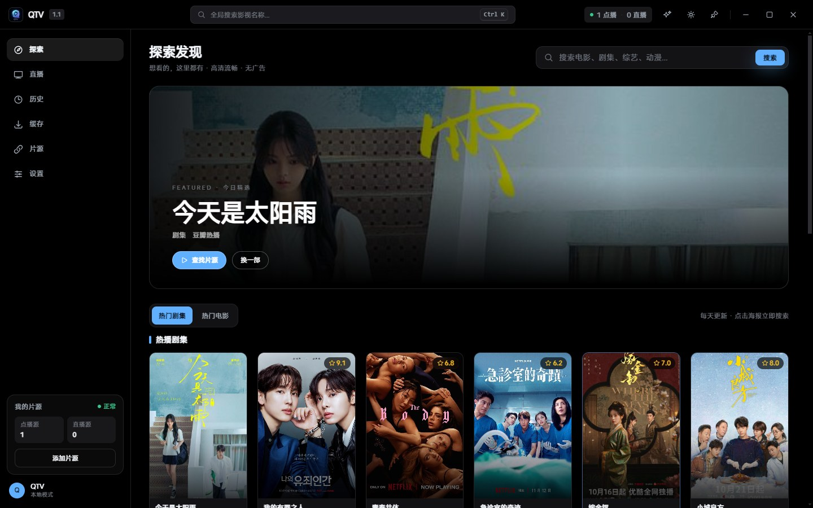 | 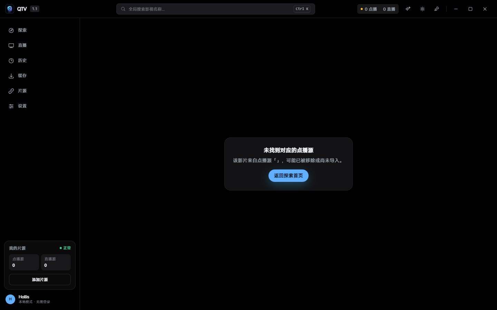 | 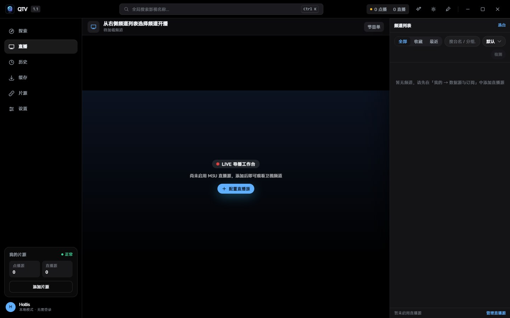 |

| 设置 | 片源管理 | 离线缓存 |
| :---: | :---: | :---: |
| 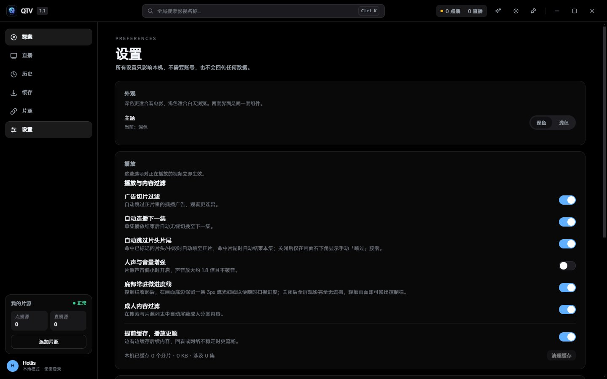 | 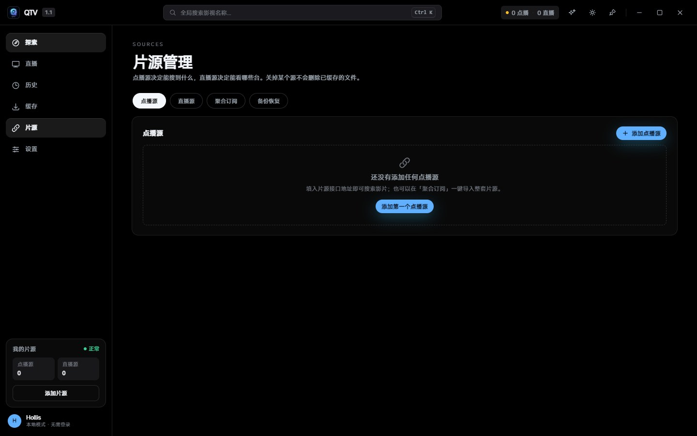 | 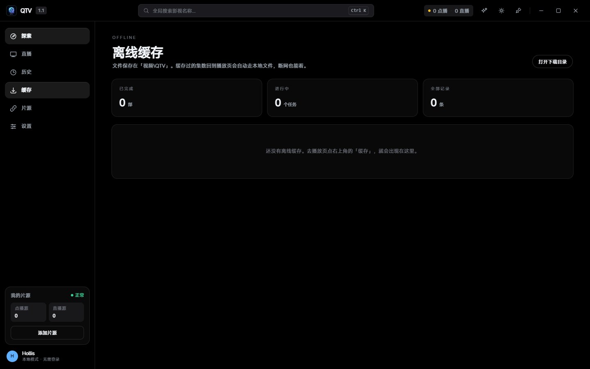 |

| 详情（居中） | 聚合搜索 | 关于 |
| :---: | :---: | :---: |
| 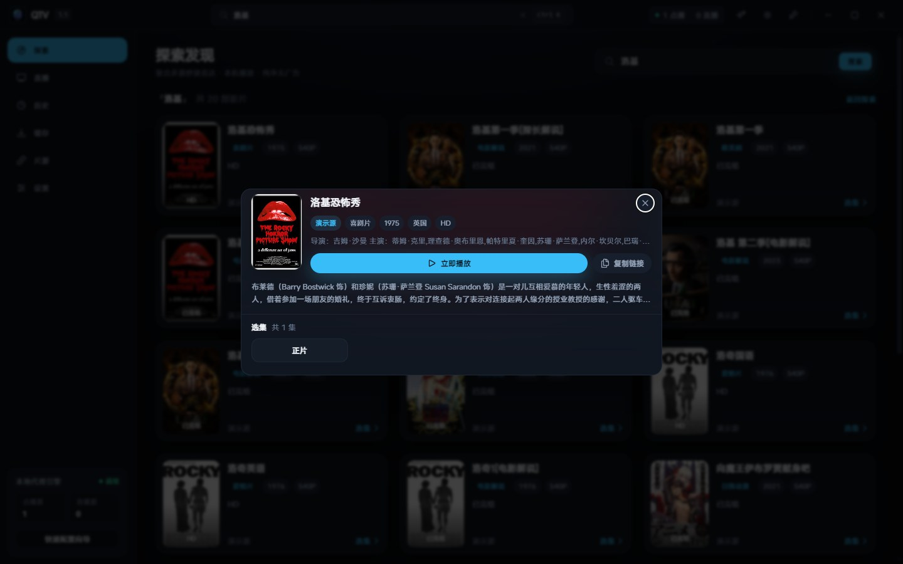 | 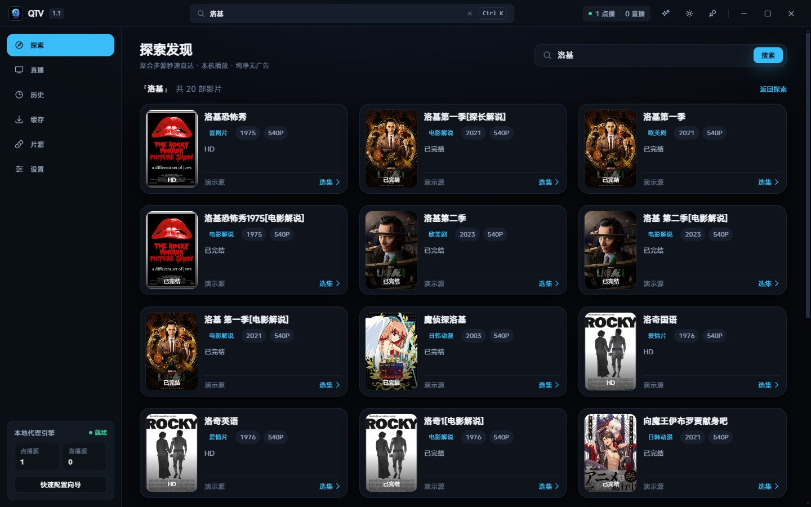 | 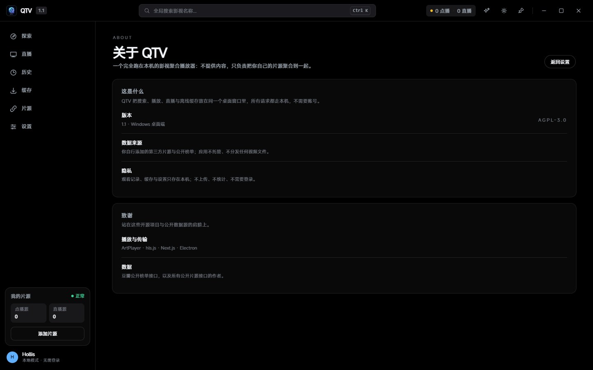 |

| 新手引导 | 浅色主题 |  |
| :---: | :---: | :---: |
| 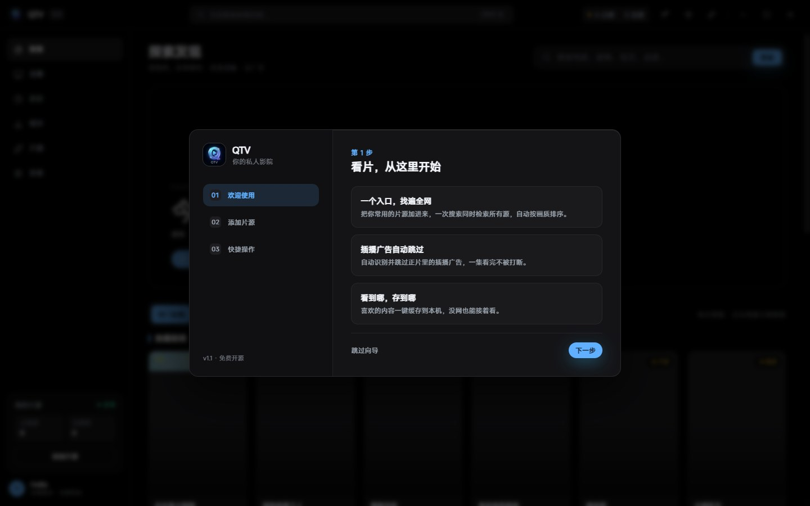 | 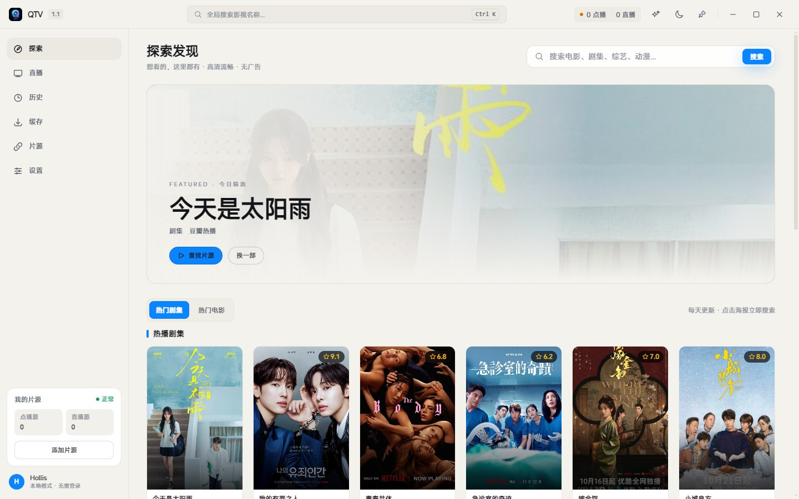 | |

**移动端**

| 探索 · 深色 | 直播中心 | 点播工作台 |
| :---: | :---: | :---: |
| 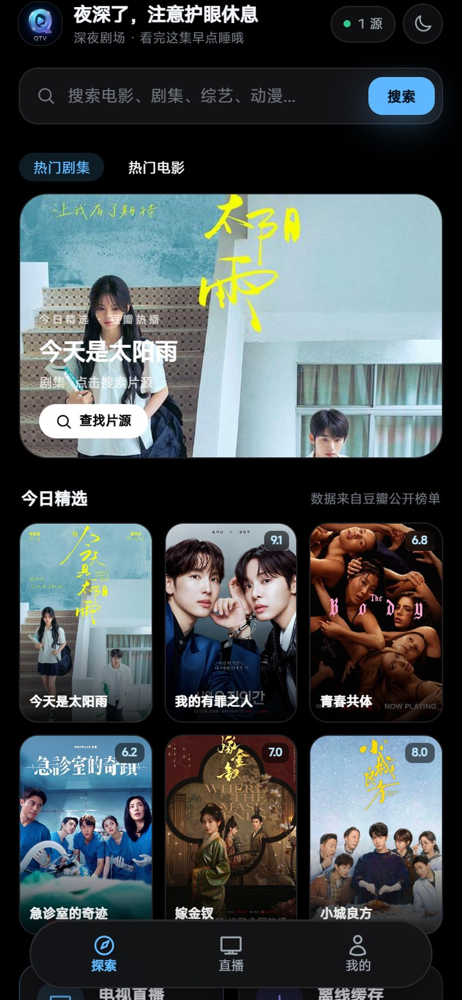 | 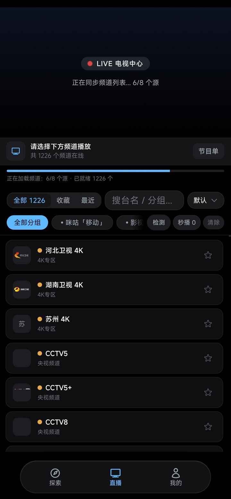 | 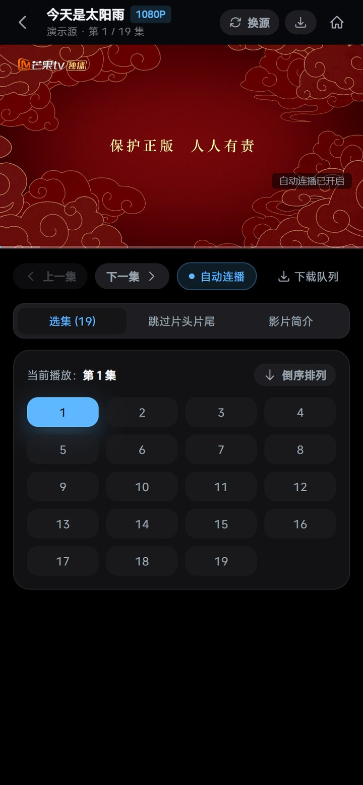 |

| 探索 · 浅色 | 我的 | 离线缓存 |
| :---: | :---: | :---: |
| 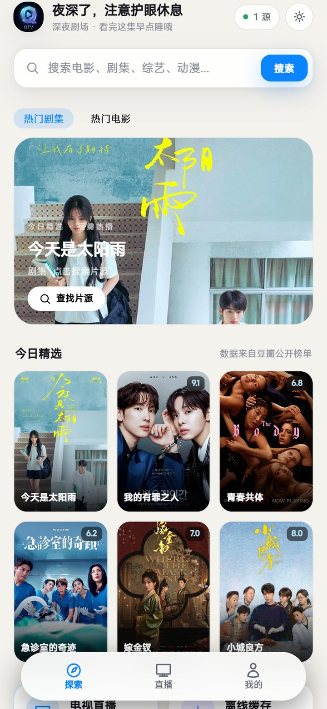 | 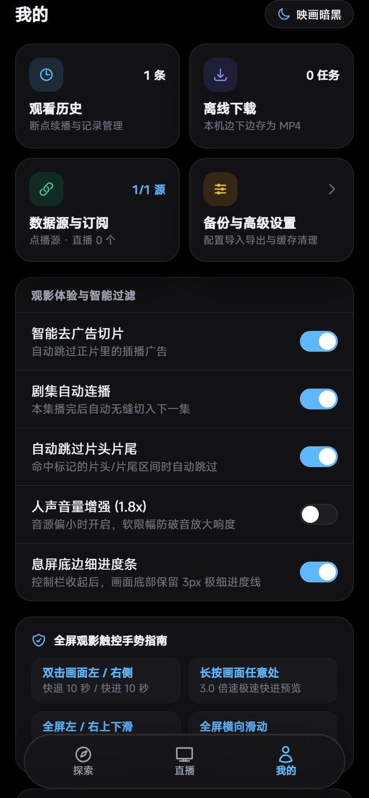 | 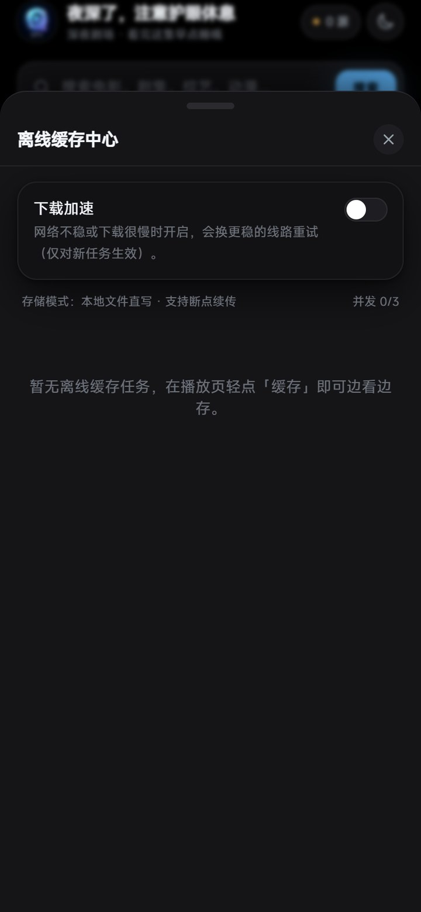 |

## 功能特性

- **无服务端直连**：本地完成接口聚合、跨域代发、GBK/UTF-8 自动转码与重定向追踪，装机即用。
- **多源并发搜索**：支持导入自定义采集站、CMS 接口与 TVBox 订阅链接，并发检索并自动探测源站画质与响应延迟。
- **M3U8 切片去广告**：内置 HLS 清单解析与代理重写管线，基于 `EXT-X-DISCONTINUITY`、分片时长特征与路径规则过滤插播广告切片。
- **电视直播与节目单**：M3U 直播源导入、频道分组切换、多线路无缝换源，XMLTV（含 `.xml.gz`）EPG 电子节目单。
- **离线缓存**：HLS 视频流合并导出到系统相册/下载目录（Android `MediaStore`）、iOS「文件」App、Windows `Videos\QTV`；缓存完成后记住文件位置，缓存中心可「播放 / 打开位置」，回到同一集自动改走本地文件（断网也能看）。
- **移动端交互**：底部三栏导航（探索 / 直播 / 我的）、底部抽屉、**全屏下**左半屏调亮度 / 右半屏调音量 / 横滑拖进度 / 双击快进退 10s / 长按 3 倍速，自动横屏，45 分钟观影提醒。
- **Windows 桌面端交互**：无边框 Mica 标题栏 + 左侧导航栏、`Ctrl+K` 全局搜索、窗口置顶 / 16:9 迷你播放窗、托盘常驻、关闭到托盘、窗口位置记忆。
- **数据备份与迁移**：源列表、订阅地址、观看历史与播放器设置一键导出为 JSON 备份文件（向下兼容旧版 `LibreTV-Settings`）。

## 安装说明

前往仓库 [Releases](https://github.com/HapyRain/QTV/releases) 或 Actions 构建产物页面下载：

| 平台 | 系统要求 | 安装方式 |
| :--- | :--- | :--- |
| **Android** | Android 8.0 (API 26) 及以上 | 下载 `.apk` 直接安装 |
| **iOS / iPadOS** | iOS 15.0 及以上 | 使用 Xcode 自行构建、签名并安装（v1.1 起不提供 `.ipa`） |
| **Windows** | Windows 10 / 11 (x64) | `QTV-1.1-Windows-x64.exe` 为安装包；`QTV-1.1-Windows-Portable-x64.exe` 为免安装便携版 |

> **iOS 分发说明**
>
> 自 v1.1 起，项目不再提供 iOS 预编译安装包（`.ipa`）或签名分发包。iOS 端源码与工程已与 Android / Windows 对齐，功能实现完整；但受 Apple 开发者签名、设备调试条件与分发合规限制，项目不承担 iOS 的签名与分发工作。
>
> 需要使用 iOS 版的用户，请自行使用 Xcode 配置开发者账号与证书后构建安装。仓库中的 CI 仅执行 iOS 编译校验，不产出可分发的安装包。

### 首次配置数据源

应用不内置任何影视内容，首次打开后：

1. 进入底部 **「我的」** → 点 **「数据源与订阅」**，打开 **「片源与偏好设置」** 面板（Windows 端为左侧栏「片源」）。
2. **聚合订阅**：在「片源管理 → 聚合订阅」粘贴 QTV 源列表链接或 TVBox 接口 JSON 链接，点同步批量导入。
3. **手动点播源**：在「片源管理 → 点播源」单独添加 CMS 采集接口并勾选启用（未勾选不参与搜索）。
4. **直播源**：在「片源管理 → 直播源」添加 `.m3u` / `.m3u8` 地址及可选 EPG；也可从「直播」页的「管理直播源」进入。

## 从源码构建

### 环境要求

- **Web 前端**：[Node.js](https://nodejs.org/) 20+
- **Android**：JDK 17、Android SDK (API 36)
- **iOS**：macOS 14+、Xcode 15+
- **Windows**：Windows 10/11、Node.js 20+（Electron 由 npm 安装）

### 1. 构建前端静态资源（三端共用）

```bash
cd web && npm ci && cd ..
node scripts/build-web.mjs
```

脚本会做「构建期手术」：复制到临时目录 → 删除 `src/app/api`（各端本地 API 实现接管全部 `/api/*`）→ 打开 `output:'export'` → SW 置空 → 给 HTML 注入 `fetch` 补丁（POST → GET + base64 `__body`，因为 WebView 拦截与本地服务都拿不到 POST body）→ 同步到：

- `app/src/main/assets/www`（Android）
- `ios/QTV/Resources/www`（iOS）
- `windows/www`（Windows 桌面端）

三份产物内容完全一致；桌面形态由运行时 `window.QTVDesktop` 判定（`web/src/lib/desktop.ts`），同一份源码在移动端仍是移动端界面。

### 2. Android

```bash
./gradlew :app:testDebugUnitTest :app:assembleDebug
# 产物 app/build/outputs/apk/debug/app-debug.apk
```

### 3. iOS

```bash
cd ios
xcodebuild -project QTV.xcodeproj -scheme QTV -configuration Release \
  -sdk iphoneos -derivedDataPath build \
  CODE_SIGN_IDENTITY="" CODE_SIGNING_REQUIRED=NO CODE_SIGNING_ALLOWED=NO clean build
```

> 以上命令仅用于编译校验；正式安装请在 Xcode 中配置自己的开发者账号与签名证书。

### 4. Windows

```powershell
cd windows
npm ci
npx electron-builder --win --x64
# 产物 windows/dist/*.exe（NSIS 安装包 + Portable 便携版）
```

一键打包（含前端资源）：`pwsh -NoProfile -File scripts/build-windows.ps1`。
国内网络下载 Electron 慢时先设置 `ELECTRON_MIRROR` / `ELECTRON_BUILDER_BINARIES_MIRROR` 镜像环境变量。

### 5. 开发验证

```bash
cd web && npm run typecheck && npm test   # 前端类型与单测
cd windows && npm test                    # 本地 API 契约（node:test）
node scripts/smoke-desktop.mjs            # Electron 冒烟（需 windows/node_modules）
```

`scripts/smoke-desktop.mjs` 会真实启动 Electron，断言桌面壳、原生桥与本地 API，并把三张截图写到临时目录；加 `--exe <path>` 可以改为验证打包后的安装包。
没有安装 Electron 时，`pwsh -NoProfile -File scripts/start-windows.ps1` 会用本地 API + 浏览器 App 模式预览（仅开发用）。

## 目录结构

```
.
├─ app/                        Android 原生工程（Kotlin）
│  ├─ src/main/java/org/qtv/app/
│  │  ├─ MainActivity.kt         WebView 宿主、全屏旋转、保存桥、返回键、崩溃重建
│  │  ├─ api/LocalApi.kt         本地 /api/* 实现（含 M3U8 代理重写与去广告）
│  │  ├─ core/network/           OkHttp 客户端与字符集解码
│  │  ├─ data/                   CMS 检索、TVBox 解析、M3U/EPG 解析、画质探测
│  │  └─ player/hls/             M3U8 广告分片过滤
│  └─ src/main/assets/www/       预构建前端产物（由脚本生成，已提交）
├─ ios/                        iOS 原生工程（Swift）
│  ├─ QTV.xcodeproj/             Xcode 工程（含共享 Scheme）
│  └─ QTV/App · Api · Data · Resources/www
├─ windows/                    Windows 桌面端（Electron）
│  ├─ main.mjs                   主进程：无边框窗口、托盘、置顶/迷你窗、分片下载、窗口状态
│  ├─ preload.cjs                contextBridge：QTVDesktop（窗口控制）与 QTV（原生保存桥）
│  ├─ local-api-server.mjs        本地回环 HTTP 服务：静态站点 + 全套 /api/* 实现
│  ├─ local-api-server.test.mjs   本地 API 契约测试（node --test）
│  └─ www/                       预构建前端产物（由脚本生成，已提交）
├─ web/                        三端共用前端源码（Next.js + React + TS + Tailwind）
│  ├─ src/app/                   页面路由：探索 · 直播 · 点播 · 历史 · 缓存 · 片源 · 设置 · 关于
│  ├─ src/components/            播放器、直播、设置等组件（desktop/ 下为桌面端形态）
│  ├─ src/lib/                   解析、缓存、画质、手势等纯逻辑（含 vitest 单测）
│  └─ public/                    图标、离线页、播放器待机海报
├─ scripts/build-web.mjs        前端 → 三端资产 一键构建
├─ docs/screenshots/            移动端 / 桌面端截图（README 引用）
└─ .github/workflows/           CI：前端检查 + Android APK + iOS 编译校验 + Windows 安装包
```

## CI

`.github/workflows/build-mobile.yml` 在每次 push 时：前端 `npm ci` + typecheck + 单测 → 构建三端资产 → Android / Windows 产出安装包，iOS 仅执行编译校验（不产出分发包）

| Job | Runner | Artifact |
| :--- | :--- | :--- |
| Build Android APK | ubuntu-latest | `QTV-Android-APK` |
| Build iOS (compile only) | macos-15 | —（不产出分发包） |
| Build Windows Desktop | windows-latest | `QTV-Windows-x64`（安装包 + 便携版） |

## 升级与兼容说明

- 包名 / Bundle ID：Android & iOS `org.qtv.app`，Windows `org.qtv.desktop`。
- 原生桥保留双通道：`window.QTV`（主）与 `window.LJJTV`（兼容）；深链 `qtv://` 与 `ljjtv://` 同时注册。
- 配置导入向下兼容：旧版 `LibreTV-Settings` 备份 / `LibreTV-SourceList` 订阅仍可导入；新导出为 `QTV-Backup_*` / `QTV-SourceList_*`。

## 致谢与免责声明

- 前端基础架构衍生自 [LibreTV](https://github.com/LibreSpark/LibreTV)，遵循 [AGPL-3.0](https://www.gnu.org/licenses/agpl-3.0.html) 开源。
- 播放器：[ArtPlayer](https://artplayer.org/) + [hls.js](https://github.com/video-dev/hls.js)；桌面端：[Electron](https://www.electronjs.org/)。
- **免责声明**：QTV 仅提供本地播放器界面与公开网络接口检索工具，不存储、不制作、不分发任何音视频文件；所有内容由用户自行配置的第三方源站提供，使用产生的版权与合规风险由使用者承担。
